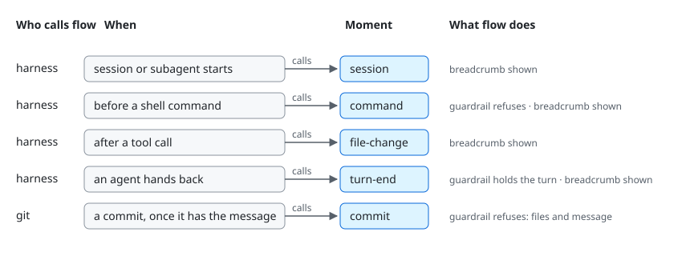

# How flow works

flow gives a coding agent two kinds of guidance, at five moments of its work.

## Two kinds of guidance

- **A guardrail** refuses. It is a check that refuses a commit or a command, or holds a turn open, and says why.
- **A breadcrumb** tells. It is text shown to the agent, such as "this code runs in a Worker, no Node natives".

flow has no warnings. A rule either refuses or it is a breadcrumb. An agent learns to read past a warning.

## Five moments

A moment is when a rule runs. What a moment takes follows from two facts about it:

- **A guardrail needs a moment before the thing happens.** After it, there is nothing to refuse.
- **A breadcrumb needs a moment where flow can add text to the agent's context.**

| Moment | When | Takes |
| --- | --- | --- |
| `commit` | git is about to record a commit | a guardrail |
| `command` | before a shell command runs | a guardrail, a breadcrumb |
| `turn-end` | an agent is about to hand back | a guardrail, a breadcrumb |
| `session` | a session or a subagent starts | a breadcrumb |
| `file-change` | after a tool call changed a file | a breadcrumb |



The harness is the program that runs the agent: Claude Code or Codex. It calls flow at four of the moments. Git calls flow at the commit. The same `flow.config.ts` guards a repo under both harnesses. [Moments](../reference/moments.md) has each one exactly.

## Why content is judged at the commit

An agent writes a file in many ways: an edit tool, `sed -i`, a heredoc, a script, a recipe. Under Codex every write is a shell command. A rule that judges each write must work out what a shell line changed. It is wrong each time it cannot read the line in full.

At a commit, git holds the staged files and the message whole, whichever tool wrote them. A commit rule judges that content once, before the work becomes history. It runs under every harness, and for a person who commits in a terminal.

So every content rule is a commit rule: the lint, the tests, the coverage bar, a banned pattern, a protected file, the format of the message. flow does not stop a write. An agent that writes a file against a rule is refused when it commits. Until then the file is in the working tree, and git still has the last commit.

## Where a rule goes

| Kind of thing | Where it goes |
| --- | --- |
| Cannot be undone and leaves the machine, such as a force-push | A guardrail at `command` |
| Content quality, and anything said in a commit message | A guardrail at `commit` |
| A preferred way of working | A breadcrumb at `session`, or a redirect at `command` |
| A recoverable mistake, such as discarding your own edits | Nothing, or a breadcrumb |
| Who may do what | The agent's tool list, in the harness, or a guardrail bound to that type of agent |

A command guardrail is for an exact command you can name in words. A rule about what a shell line does to a file is a commit rule, or a breadcrumb.

## `flow.config.ts` is the whole guard

`flow.config.ts` is one TypeScript file at the repo root. A rule that cannot be reached from it does not run. There is no rule library on the machine, and nothing resolves at run time. So the file lists exactly what runs.

The file is code for a reason. A misspelled verb is a red squiggle in your editor, and a rule that does not compile never loads. The mistake shows where you write it, before anything runs.

## Packs and overrides

The file has two verbs: it binds **packs**, and it states **overrides**. The rules are in the packs, so the config stays short: it is the list of them.

```
import { defineConfig, override, pack } from "@jawache/flow";
import { flow } from "@jawache/flow/packs";
import { house } from "./guards/house.ts";

export default defineConfig([
  pack(flow),                                         // bind a pack, and every entry in it
  pack(house),
  override(house.noForcePush).disabled("scratch repo — history is disposable here"),
]);
```

- **`pack(x)`** binds a pack and every entry in it.
- **`override(x.entry)`** states only what it changes, such as a different `.on(…)`, a different `.message(…)`, or `.disabled("why")`. Everything it leaves out comes from the pack. It can never change the entry's `.check(…)` or `.test(…)`.

An override replaces the key it names. A narrowed `.on(…)` is the whole list, never a merge. Where two repos disagree about one entry, the second one overrides it. It does not fork the pack. The override is a committed line in its config, so the difference between the repos stays visible. `flow status` prints the reason for an entry turned off with `.disabled("why")`.

## A pack is code

A pack is an ordinary TypeScript module. flow ships one, `flow`, which protects the guard itself. Every other pack is yours:

- **In `guards/`.** A pack about your repo's own rules.
- **In a package of its own.** Rules that a second repo also needs. Each repo installs the package and imports the pack.

The rules are the same in both places. Only the import path differs. A pack that needs a fact about the repo declares it as a mandatory typed parameter. A config that binds the pack without the fact does not compile. [How to write your own check, and share rules as a pack](../how-to/write-your-own-check.md) gives the steps.

## A sentence states the whole rule

```
noForcePush: guardrail()
  .at(command)
  .check(banCommands({ ban: ["git push --force", "git push -f"] }))
  .message("Force-pushing rewrites history everyone else has. Push a correcting commit, or ask first.")
  .test({ pass: ["git push origin main"], block: ["git push --force origin main"] }),
```

Each verb is one part of the rule:

| Verb | Part |
| --- | --- |
| `.at(…)` | when it runs |
| `.on(…)`, `.ignore(…)` | which files |
| `.for(…)` | which actor |
| `.check(…)` | the question |
| `.message(…)` | what the refused agent reads |
| `.test({ pass, block })` | what proves it |

- **A verb written twice is a compile error.**
- **A check is a function of `ctx`,** and `ctx` is its only access to files, commands and git. So the same check runs live, runs in a test case, and replays from a recording with no repo.
- **A category reads evidence the harness wrote.** [Rules bound to who](./rules-bound-to-who.md) explains why.
- **Every rule has its own cases.** A guardrail with no block case does not load. A block case is what proves the rule refuses something.

---

[Index](../index.md) · when each rule runs: [the moments](../reference/moments.md) · every verb: [the config reference](../reference/config.md) · what flow can and cannot read: [what flow reads](./what-flow-reads.md) · try it: [getting started](../tutorials/getting-started.md)
